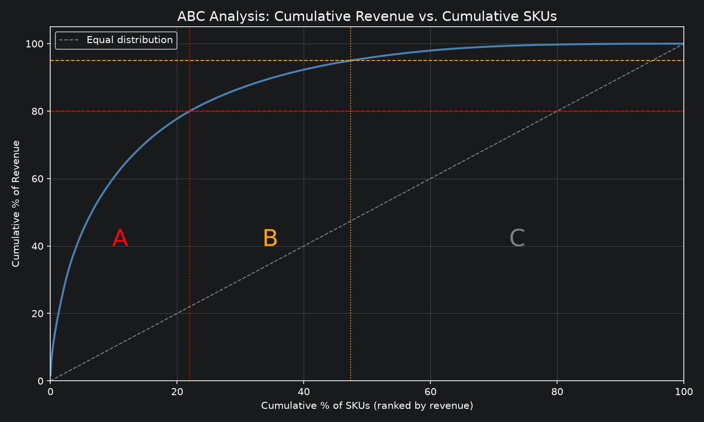
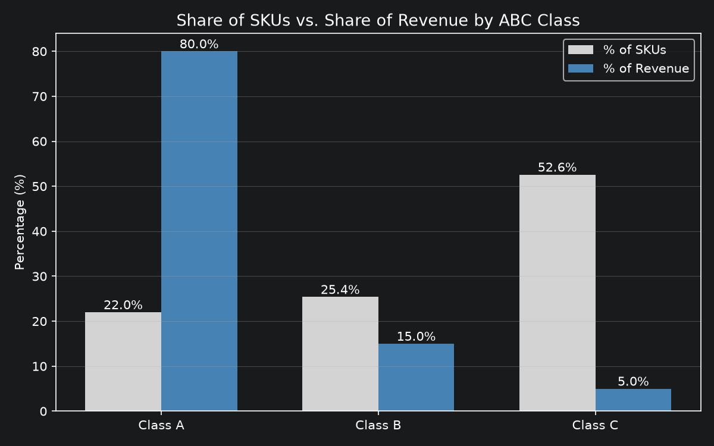

# Inventory ABC Analysis

> 库存 ABC 分类分析：用 Python 处理 54 万条英国线上零售交易记录，按年度净销售额对 3,790 个商品进行 ABC 分类，并提出差异化的库存管理建议。

## Overview

This project applies **ABC classification** to a UK online gift retailer, using one year of real transaction data (**UCI Online Retail II**, Dec 2010 – Dec 2011, 541,910 transaction lines).

The dataset contains sales transactions but no stock levels or unit costs, so SKUs are classified by **annual net revenue** (sales minus cancellations and returns). This is a revenue-based version of the standard "annual dollar usage" criterion used in inventory ABC analysis.

## Key Findings

| Class | SKUs | % of SKUs | % of Net Revenue |
|---|---|---|---|
| A | 833 | 22.0% | 80.0% |
| B | 964 | 25.4% | 15.0% |
| C | 1,993 | 52.6% | 5.0% |

- **22% of SKUs generate 80% of net revenue**, a classic Pareto pattern.
- More than half of all SKUs (Class C) contribute only 5% of revenue.
- Top sellers are home décor, party supplies and seasonal gifts. The No.1 SKU, *Regency Cakestand 3 Tier*, alone generated about GBP 164k.
- **Data issue found and fixed:** the first cleaning pass removed cancellation records but kept the original orders, so cancelled orders were still counted as sales. For example, SKU 23843 ranked 2nd by quantity (80,995 units) although the whole order was cancelled 12 minutes later. Switching to net revenue corrected an overstatement of about 5%. The overall conclusion did not change, but the numbers became more accurate.

## Charts

**Pareto curve: cumulative revenue vs cumulative SKUs**



**Share of SKUs vs share of revenue by class**



## Methodology

### 1. Data quality check (count first, delete later)
- Missing values: `Customer ID` is missing for about 25% of lines. These lines were **kept**, because ABC classification is at SKU level and does not depend on who the customer is.
- Counted cancellations (9,288), lines with quantity ≤ 0 (10,624), price ≤ 0 (2,517) and exact duplicates (5,268).
- Non-product codes (postage, bank charges, Amazon fees, manual adjustments, gift vouchers) were found with a rule (stock code not starting with a digit) and then **reviewed manually**, because the rule also catches some real products.

### 2. Net revenue correction
- Kept cancellations and returns as negative lines so they **offset** the original orders.
- Removed stock adjustments (negative quantity but not a customer cancellation), zero-price lines, non-product codes and duplicates.
- Removed one confirmed data-entry error (invoice 556444: a customer entered 60 cases instead of 1 case, and re-ordered the correct amount 5 minutes later).
- Excluded 23 SKUs with net revenue ≤ 0. **3,790 SKUs** remain for classification.

### 3. Price outlier review
- Flagged 393 lines priced above 10× the SKU's median price. Together they total only about GBP 4,759, and most reflect pack pricing. They were kept, as their impact on the result is negligible.

### 4. ABC classification
- Ranked SKUs by net revenue and calculated cumulative share.
- **A:** cumulative share ≤ 80% · **B:** 80%–95% · **C:** last 5%.

## Inventory Recommendations

| Class | Approach |
|---|---|
| A | Tight control: improve forecast accuracy and service level, count frequently, avoid stock-outs |
| B | Standard control with periodic review |
| C | Simplified control and lower stock levels; review range rationalisation, while protecting new, seasonal and complementary items |

## Limitations & Next Steps

- Classification uses revenue only, not profit or demand variability. A next step is **XYZ analysis** (demand variability).
- Only one year of data, so seasonal items are hard to judge.
- Safety stock and reorder points could be calculated for Class A items.

## Repository Structure

```
inventory-abc-analysis/
├── abc_inventory_analysis.ipynb     # Full analysis with code and outputs
├── abc_classification_result.csv    # ABC class for each of the 3,790 SKUs
├── *.png                            # Charts used in this README
└── README.md
```

## How to Reproduce

1. Download `online_retail_II.xlsx` from the [UCI Machine Learning Repository](https://archive.ics.uci.edu/dataset/502/online+retail+ii) and save it as `data/online_retail_II.xlsx`.
2. Install the required packages:
```
   pip install pandas matplotlib openpyxl jupyter
```
3. Open `abc_inventory_analysis.ipynb` and run all cells. The notebook reads the sheet "Year 2010-2011", saves charts to `images/` and exports results to `data/`.

## Data & License

- **Source:** Chen, D. (2012). *Online Retail II* [Dataset]. UCI Machine Learning Repository. https://doi.org/10.24432/C5CG6D
- **License:** [CC BY 4.0](https://creativecommons.org/licenses/by/4.0/)
- The raw data file (43.5 MB) is not included in this repository because of its size. Please download it from the source above.

## Tools

Python · pandas · matplotlib · Jupyter Notebook
